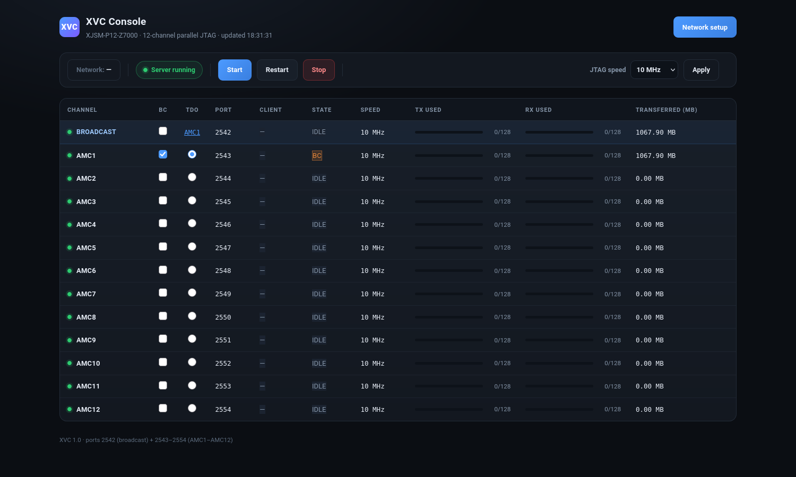

# XJSM-P12-Z7000 — Broadcast + 12-Engine XVC Remote JTAG

A **broadcast + 12-channel XVC (Xilinx Virtual Cable) server** implemented on a
**AMD Xilinx Zynq-7020 (AC7Z020)**, providing network-based remote JTAG access to
an external **AMD Xilinx FPGA** scan chain — replacing a traditional USB JTAG
cable. Includes a 0.96" OLED status display and a web console.

> In one sentence: turn a small Zynq board into a 13-port network JTAG debugger.

---

## System Overview

```
                ┌──────────────────────────────────────────────┐
                │  AC7Z020 (XC7Z020)                           │
                │  ┌────────────┐   ┌───────────────────────┐  │                ┌─────────────┐
 PC / Vivado ──►│  │ PS: Linux  │   │ PL: 13× jtag_ctrl     │────► J20 G1/G2 ──►│ AMD Xilinx  │
  TCP 2542/2543 │  │            │──►│ + broadcast engine    │  │                │ FPGA        │
  ... 2554      │  │ xvcserver  │   │ + I2C1 EMIO           │  │                │             │
                │  └────────────┘   └─────────────┬─────────┘  │                └─────────────┘
                └─────────────────────────────────┼────────────┘
                                                  │ I2C1 (J20 pin33/35)
                                                  │
                                                  ▼
                                          ┌────────────────────┐
                                          │  OLED  SSD1315     │
                                          │  128×64, I2C1      │
                                          └────────────────────┘
```

| Component | Description |
|---|---|
| **13 JTAG engines** | `jtag0..11` @ `0x43C00000 + ch*0x10000` (12 independent channels) + `jtag12` @ `0x43CC0000` (broadcast-only engine) |
| **Broadcast register block** | `0x43CD0000`: `CTRL / BCMASK / CHSEL / TAG` |
| **XVC server** | TCP `2542` (broadcast) + `2543..2554` (ch0..ch11), one session per channel |
| **Web console** | `http://<board>/` — port status, mask, TCK, reset |
| **OLED** | 128×64, shows 12 port states / broadcast mask / IP / TCK |

### Web console



`http://<board>/` — live view of all twelve channels plus the broadcast engine:
per-channel **BC** membership and **TDO** source selection, client connection,
state, TCK, FIFO occupancy and data moved. The **BROADCAST** row (top) shows the
aggregate; its TDO cell names the channel currently feeding the broadcast TDO,
and clicking it clears the mask. Details in
[`xvc/docs/WEB_CONSOLE.md`](xvc/docs/WEB_CONSOLE.md).

---

## Port Assignment

| Port | Purpose | Notes |
|---|---|---|
| `2542` | **Broadcast** | Requires a non-empty BCMASK to carry any signal |
| `2543` | ch0 = **G1** | ← **this is what Vivado normally uses** |
| `2544..2554` | ch1..ch11 | |
| `80` | Web console | |

---

## Quick Start

### 1. Flash the SD card

Copy the two files from `release/v16/` (or `xvc/out/v16/sd_card/`) to the **FAT32**
root of an SD card:

```
BOOT.BIN      5,177,792 B   md5 835b415252fe70d7b8522620578bda28
image.ub     17,870,984 B   md5 d8685f5975a001ffd71e3eea0e7f11ee
```

Insert the card and power up. (This carrier board has **no QSPI flash**; it can
only boot from SD.)

### 2. Log in

```
root / <password set when the image was built>
```

No password ships in this repository. The image is built with placeholder
hashes, so set your own before building — see
[`xvc/docs/MANUFACTURING.md`](xvc/docs/MANUFACTURING.md) §8.4.

### 3. Connect from Vivado

```
Open Hardware Manager → Open Target → Open New Target
  → Add Xilinx Virtual Cable (XVC)
  → Host: <board IP>    Port: 2543
```

### 4. Program a bitstream

```tcl
open_hw_manager
connect_hw_server -url localhost:3121
open_hw_target -xvc_url 192.168.1.113:2543
set dev [lindex [get_hw_devices xc7k325t*] 0]
set_property PROGRAM.FILE {top.bit} $dev
program_hw_devices $dev
```

---

## Repository Layout

```
xvc/
├── vivado/                     FPGA side
│   ├── rtl/                    Verilog sources (jtag_ctrl / jtag_bcast_regs / i2c_*)
│   ├── constraints/            XDC
│   ├── build_jtag12p.tcl       one-shot build script
│   └── out_jtag12p/            system_wrapper.bit + system.xsa
├── petalinux/
│   ├── apps/                   server / xvcinfo / oled_ip / i2cprobe sources
│   └── xvc/project-spec/       meta-user recipes (the only config that must persist)
├── web/                        Web console (index.html + CGI)
├── tests/                      fulltest_v12.py (76 checks)
├── tools/                      debug scripts (TCL / Python)
├── sim/                        RTL simulation (cocotb style)
├── docs/                       27 design / build / manufacturing documents
└── out/v16/                    ready-to-use release artifacts
sw/oled/                        OLED application (for cross-compiling on the host)
test_bits/                      test bitstreams
```

---

## Key Documents

| Document | Contents |
|---|---|
| [`xvc/docs/MANUFACTURING.md`](xvc/docs/MANUFACTURING.md) | **Factory programming work instruction** (~800 lines, 18 end-of-line checks) |
| [`xvc/docs/STATUS.md`](xvc/docs/STATUS.md) | Overall project status, versions, checksums |
| [`xvc/docs/BLOCK_DIAGRAM.md`](xvc/docs/BLOCK_DIAGRAM.md) | System / RTL block diagram, state machine |
| [`xvc/docs/BUILD_DEPLOY_GUIDE.md`](xvc/docs/BUILD_DEPLOY_GUIDE.md) | Complete build & deployment guide |
| [`xvc/docs/KNOWN_ISSUES.md`](xvc/docs/KNOWN_ISSUES.md) | **35 pitfalls hit** (with root cause and fix) |
| [`xvc/docs/PETALINUX_LOCAL_BUILD.md`](xvc/docs/PETALINUX_LOCAL_BUILD.md) | Offline PetaLinux build |
| [`xvc/tests/README.md`](xvc/tests/README.md) | Test suite description |
| [`xvc/docs/pg245-v2.0.pdf`](xvc/docs/pg245-v2.0.pdf) | AMD **PG245 Debug Bridge v2.0** — the `From_AXI_to_JTAG` mode `jtag_ctrl` implements |
| [`NOTICE`](NOTICE) | Third-party content and licensing notes |

---

## Register Map (per engine)

| Offset | Name | Description |
|---|---|---|
| `0x00` | LEN | Number of bits to shift |
| `0x04` | TMS | 32-bit TMS data |
| `0x08` | TDI | 32-bit TDI data |
| `0x0C` | TDO | Read-back |
| `0x10` | CTRL | bit0 start (self-clearing) / bit2 FIFO flush |
| `0x14` | DIV | TCK divider = `100 MHz / (2*DIV)`; reads back PL_TAG `0xA7000000` |
| `0x18` | DIV_RB | Divider read-back |
| `0x1C` | TXD | FIFO write |
| `0x20` | RXD | FIFO read |
| `0x24` | STATUS | `[7:0]` tx_free / `[15:8]` rx_used |
| `0x28` | DONE | Completed-shift counter |
| `0x2C` | PH | Phase counter (debug) |
| `0x30` | STATE | `[9:8]` state / `[7:2]` bits / bit1 streaming / bit0 busy |
| `0x34` | START | |
| `0x38` | SEQ | Upper 16 bits = go_seq |
| `0x3C` | CHSEL | |
| `0x40` | BCMASK | |

Broadcast register block `0x43CD0000`:

| Offset | Name | Description |
|---|---|---|
| `0x00` | CTRL | bit0 `bcast_en` |
| `0x04` | BCMASK | 12-bit mask (0 = take over no channel) |
| `0x08` | CHSEL | TDO source |
| `0x0C` | TAG | `0xB7000000` |

---

## Resources and Performance

| Metric | Value |
|---|---|
| LUT | 9,057 (17.02%) |
| FF | 7,589 (7.13%) |
| IOB | 48 / 125 |
| WNS / WHS | +0.307 ns / +0.048 ns |
| Failing endpoints | 0 |
| Shift throughput, CPU paths | 5.6–7.2 Mbit/s at TCK 10 MHz (see *Speed: HS2 cable vs the three XVC paths*) |
| Shift throughput, DMA | **9.96 Mbit/s** — 99.6% of the 10 MHz wire rate |
| Per-shift latency | 0.21–0.26 ms (6 bit) |
| Full bitstream (Kintex-7 325T, 91.5 Mbit) | CPU path **15.9 s** / DMA **9.19 s** |
| Flash programming, 34.7 MB image | XVC **18 min 43 s** / local USB HS2 **14 min 02 s** |

---

## How the Performance Is Achieved

The numbers above are not luck — they come from moving work out of software and
into the PL. Four mechanisms do the heavy lifting.

### 1. Hardware TCK generation, not bit-banging

The CPU **never** toggles a JTAG pin. `jtag_ctrl` owns a phase counter clocked by
the 100 MHz PL clock and derives TCK from it:

```
TCK half period = DIV cycles        →        TCK = 100 MHz / (2 · DIV)
```

A 32-bit chunk therefore costs the CPU only **four register writes and one read**
(LEN, TMS, TDI, CTRL.start → TDO); the 32 TCK edges happen entirely in hardware.
That is the difference between "software toggling at a few hundred kHz" and a
10 MHz line rate.

### 2. 32-bit parallel shift per transaction

Each `shift` command is decomposed into 32-bit chunks. One chunk is one AXI4-Lite
burst into the engine, and the engine shifts all 32 bits back-to-back with a
single continuous TCK burst — no per-bit round trip, no CPU involvement. This is
the register interface PG245 specifies for the Debug Bridge in
`From_AXI_to_JTAG` mode, reimplemented in `jtag_ctrl.v`.

### 3. Broadcast engine: twelve targets program at once

This is the biggest win, and the reason the design has a 13th engine.

`jtag_bcast_mux` does not replicate the shift; it **steers** it:

```verilog
assign follow[i]  = bcast_en & bcmask_eff[i];
assign pin_tck[i] = follow[i] ? bc_tck : ch_tck[i];
assign pin_tms[i] = follow[i] ? bc_tms : ch_tms[i];
assign pin_tdi[i] = follow[i] ? bc_tdi : ch_tdi[i];
```

Every channel in the mask sees the **same TCK/TMS/TDI**, each with its own
**independent TDO**. Programming 12 identical boards therefore takes **the same
wall-clock time as programming one** — a straight 12× on a production line.

### 4. Deep transmit/receive FIFOs

`jtag_ctrl` contains a **128 × 32-bit TX** and a **128 × 32-bit RX** FIFO with
modulo-256 pointers and hardware full/empty guards. `0x1C TXD` pushes a TDI word,
`0x20 RXD` pops a TDO word, and `0x24 STATUS` reports `tx_free` / `rx_used` so
software can pace itself without polling the engine state.

The engine is also wired for **autonomous streaming**: in `S_IDLE`, whenever the
TX FIFO is non-empty it starts a 32-bit chunk by itself (`TMS` forced to 0, `TDI`
taken straight from the FIFO), then pushes the captured TDO into the RX FIFO —
one hardware shift per queued word, with no software trigger at all.

> **Current status**: the streaming path is **enabled and verified** — a
> 1 Mbit loopback through a Kintex UltraScale+ KU15P comes back **100% bit-exact**
> (previously 50% at 65,536 bits, see [`KNOWN_ISSUES.md`](xvc/docs/KNOWN_ISSUES.md)
> #35).
>
> It does **not** make things faster, though, and the measurement says why:
>
> | Shift length | FIFO streaming | 32-bit chunked |
> |---|---|---|
> | 65,536 bit | 5.19 Mbit/s | 5.97 Mbit/s |
> | 262,144 bit | 5.82 Mbit/s | 5.82 Mbit/s |
> | 1,048,576 bit | 5.68 Mbit/s | 5.86 Mbit/s |
>
> Both paths perform **one register write per 32 bits**, so the FIFO cannot help:
> the limit is the `/dev/mem` access itself (~2–3 µs per register touch, three
> touches per word), not the shift engine. Beating it needs DMA or a wider
> register interface, not a deeper queue.

### Where the time actually goes

| Stage | Cost |
|---|---|
| AXI4-Lite register access | ~100 ns each, 4 writes + 1 read per 32-bit chunk |
| 32 TCK edges at 10 MHz | 3.2 µs per chunk |
| CPU overhead per chunk | ~3 µs (polling + `/dev/mem`) |
| **Net measured, CPU path** | **5.6–7.2 Mbit/s** (56–72% of a 10 MHz line rate) |

Measured end to end: a full **91,548,512-bit** Kintex-7 325T bitstream in
**15.9 s** = **5.76 Mbit/s**, i.e. **58% of the 10 MHz line rate**.

### Why not faster

At 10 MHz TCK a 32-bit chunk needs 3.2 µs of wire time, and the software overhead
is of the same order, so the two are balanced. Raising TCK raises the wire share
but not the overhead.

The FIFO path was implemented to attack exactly this, and the measurement shows
it does not: both paths still cost **one register access per 32-bit word**, and
that access (~2–3 µs through `/dev/mem`) is the real ceiling. Enabling streaming
made long shifts correct at high speed but no faster overall.

That next step is now implemented: **DMA** lets the PL read the bitstream from
DDR itself, so the CPU stops touching registers per word. It lands at
**9.96 Mbit/s** — faster than a local cable doing a plain JTAG scan. See
*Speed: HS2 cable vs the three XVC paths* below.

### Speed: HS2 cable vs the three XVC paths

Every path runs at the same **TCK = 10 MHz**, so they share one wire ceiling of
**10.0 Mbit/s** (one bit per TCK edge). This is the fastest each was measured
reaching it.

| Path | What moves | Time | Speed | of wire |
|---|---|---|---|---|
| **USB HS2** — local cable `Digilent/210241403684` | 1,000,000-bit JTAG scan | 137 ms | **7.30 Mbit/s** | 73% |
| **XVC · AXI4-Lite register** — PG245 `From_AXI_to_JTAG` scheme | 32-bit chunk | 4.455 µs | **7.18 Mbit/s** | 72% |
| **XVC · FIFO** — register streaming via `0x1C`/`0x20` | 262,144 bit, board-side | 3.16 µs/word | **≈10.0 Mbit/s** (wire-limited) | 100% |
| **XVC · DMA** — DDR ↔ shift engine, no CPU per word | 91,548,512 bit (whole bitstream) | 9.19 s | **9.96 Mbit/s** | **99.6%** |

One number here needs qualifying. The FIFO figure is often quoted as
**10.13 Mbit/s**, but 32 bits at 10 MHz take 3.200 µs and the measurement reports
3.160 µs — 1.3% *faster than the wire*, which is physically impossible. That is
timer/measurement error (0.04 µs over a 26 ms run), so it is quoted above as
**≈10.0 Mbit/s, i.e. at the limit**, not above it. Two consequences: the FIFO
path cannot be described as faster than DMA, and it is a board-side figure — the
same run is 5.6–5.8 Mbit/s once TCP is in the path.

The register row is the scheme PG245 defines for the Debug Bridge in
**`From_AXI_to_JTAG`** mode: the host is a bus master on the *same* chip, and the
block drives `tap_tck` / `tap_tms` / `tap_tdi` out to another board's JTAG pins.
This design implements that block directly in
[`jtag_ctrl.v`](xvc/vivado/rtl/jtag_ctrl.v) instead of instantiating the IP, so
each `shift` is split into 32-bit chunks and every chunk costs a full AXI4-Lite
round trip — write LENGTH / TMS / TDI, strobe CTRL, poll CTRL, read TDO. That
round trip, not the wire, is what costs the 28% of line rate.

**The DMA path beats a local USB cable**, 9.96 vs 7.30 Mbit/s. That is not a cable
problem — the HS2 is clocked at 10 MHz too (`PARAM.FREQUENCY` reads 10000000).
A JTAG scan is *command*-bound: one round trip per 32-bit word, which caps even a
cable at ~73% of its wire rate. DMA turns the transfer into a single stream and
reaches 99.6% without touching the clock.

Two numbers that matter once this is on a network:

| | |
|---|---|
| XVC · FIFO, end to end over TCP | 5.6–5.8 Mbit/s (56–58% of wire) — the server's software path, not JTAG |
| XVC · AXI4-Lite register, same 91.5 Mbit payload as the DMA row | 15.9 s = 5.76 Mbit/s (58%) |

So on one whole bitstream, DMA is **1.73× the CPU-driven path**: 9.19 s against
15.9 s.

### Transport comparison: the same flash job

Pure scan rates are not the whole story once a real workload is involved.
Programming the same 34.7 MB image into the same flash (MT25QU01G, 1 Gbit), same
SPI-bridge flow, only the transport changed:

| | XVC `192.168.1.113:2543` | local USB HS2 | HS2 speedup |
|---|---|---|---|
| SPI bridge download (7 MB) | 11.96 s | 11.29 s | 1.06x |
| Erase + program + verify (34.7 MB) | 1108.8 s | 828.9 s | 1.34x |
| **Total** | **18 min 43 s** | **14 min 02 s** | **1.33x** |

Both at TCK 10 MHz. The bridge stage is a wash because it is dominated by
configuration/DONE handling, and the flash stage improves only 1.34x despite the
cable having a dedicated link — flash page programming and status polling, not
the transport, set that time. Details in
[`xvc/docs/FLASH_PROGRAMMING_FINDINGS.md`](xvc/docs/FLASH_PROGRAMMING_FINDINGS.md#xvc-vs-local-usb-cable--measured-2026-11-13).

---

## DMA: CPU-Free Bulk Streaming

`jtag_ctrl` exposes **AXI-Stream ports** next to its AXI4-Lite register file, so an
`axi_dma` instance can move a bitstream between DDR and the shift engine without
the CPU touching a register per word:

```
DDR ──MM2S──► jtag0.s_axis_tdi ──► TX FIFO ──► shift engine ──► RX FIFO ──► jtag0.m_axis_tdo ──S2MM──► DDR
```

- The stream writes land in the **same 128 × 32-bit FIFO** the `0x1C TXD` register
  uses, so the engine's autonomous per-word shifting is unchanged.
- `s_axis_tdi` needs no bookkeeping; **S2MM needs `TLAST`** to know where a transfer
  ends, so register **`0x44`** loads a word count and the last word of the run
  carries `TLAST`.
- Only channel 0 is wired to the DMA. The other 12 engines have `dma_en` tied low,
  so their behaviour is bit-identical to before.
- DMA register block: **`0x40400000`**, two AXI masters into `ps7/S_AXI_HP0`.

Cost: LUT 17.02% → **21.74%**, FF 7.13% → **9.93%**; timing still met with zero
failing endpoints.

**Buffer**: the device tree adds `mem=1008M`, which leaves the top 16 MiB
(`0x3F000000 .. 0x3FFFFFFF`) outside the kernel map. Nothing else can allocate
there, so `mmap(/dev/mem)` on it gives user space a physically contiguous AXI DMA
buffer that the DMA masters reach through `S_AXI_HP0`.

**Driver**: `xvc/tools/xvcdma.c` — arms `0x44` with a word count (so the last TDO
word carries `TLAST`), points `MM2S_SA` at the TDI buffer and `S2MM_DA` at the TDO
buffer, then writes the two `LENGTH` registers and polls for idle.

Verified on hardware: bitstream `78e0b634` programmed, DMA registers respond, the
device tree reserves the pool and a 65,536-bit run moved **1917 of 2048 words**
through the DMA before a tail stall. The remaining synchronisation problem and
the measurements are tracked in
[`xvc/docs/DMA_BRINGUP.md`](xvc/docs/DMA_BRINGUP.md); the live state, the
environment and the next step are in
[`xvc/docs/SESSION_HANDOFF.md`](xvc/docs/SESSION_HANDOFF.md).

---

## Known Limitations

| Item | Notes |
|---|---|
| No QSPI | This carrier board has no configuration flash; the system lives entirely on SD |
| ramdisk root filesystem | Not persistent across power cycles; store the serial number in `SN.TXT` on the SD card |
| busybox has no `pkill` | Kill processes with `kill -9 $(ps\|grep\|awk)` |
| `-d` is an **upper bound** | `-d 5` = 10 MHz maximum; the client may request slower |
| Broadcast mask is a static reservation | Channels in the mask stay reserved after the session ends; clear the mask in the UI |

See [`KNOWN_ISSUES.md`](xvc/docs/KNOWN_ISSUES.md) for the full pitfall list.

---

## License

Project-owned code is released under the **MIT** license — see [`LICENSE`](LICENSE).
Third-party content and generated artifacts are described in [`NOTICE`](NOTICE).
Vendor documents (PG245, XAPP1251, UG908, UG470), Xilinx-generated
`ps7_init.*`, Vivado project files, and the bootable `BOOT.BIN` / `image.ub`
(which embed GPL components) are **not** distributed in this repository.
