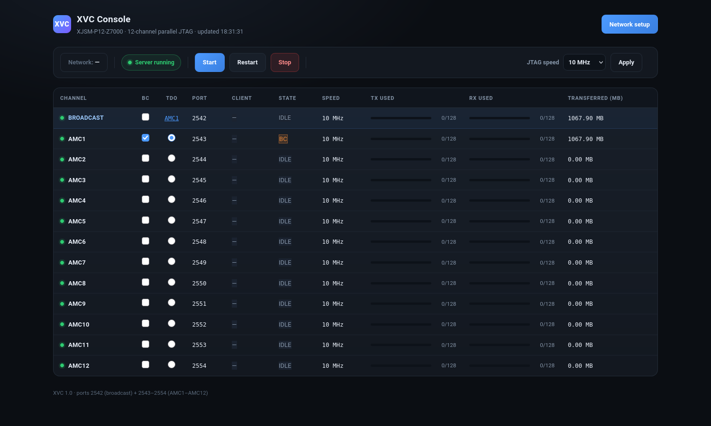

# XJSM-P12-Z7000 — Broadcast + 12-Engine XVC Remote JTAG

A **broadcast + 12-channel XVC (Xilinx Virtual Cable) server** implemented on a
**AMD Xilinx Zynq-7020 (AC7Z020)**, providing network-based remote JTAG access to
an external **AMD Xilinx FPGA** scan chain — replacing a traditional USB JTAG
cable. Includes a 0.96" OLED status display and a web console.

> In one sentence: turn a small Zynq board into a 13-port network JTAG debugger.

---

## System Overview

```
                ┌──────────────────────────────────────────────┐
                │  AC7Z020 (XC7Z020)                           │
                │  ┌────────────┐   ┌───────────────────────┐  │                ┌─────────────┐
 PC / Vivado ──►│  │ PS: Linux  │   │ PL: 13× jtag_ctrl     │────► J20 G1/G2 ──►│ AMD Xilinx  │
  TCP 2542/2543 │  │            │──►│ + broadcast engine    │  │                │ FPGA        │
  ... 2554      │  │ xvcserver  │   │ + I2C1 EMIO           │  │                │             │
                │  └────────────┘   └─────────────┬─────────┘  │                └─────────────┘
                └─────────────────────────────────┼────────────┘
                                                  │ I2C1 (J20 pin33/35)
                                                  │
                                                  ▼
                                          ┌────────────────────┐
                                          │  OLED  SSD1315     │
                                          │  128×64, I2C1      │
                                          └────────────────────┘
```

| Component | Description |
|---|---|
| **13 JTAG engines** | `jtag0..11` @ `0x43C00000 + ch*0x10000` (12 independent channels) + `jtag12` @ `0x43CC0000` (broadcast-only engine) |
| **Broadcast register block** | `0x43CD0000`: `CTRL / BCMASK / CHSEL / TAG` |
| **XVC server** | TCP `2542` (broadcast) + `2543..2554` (ch0..ch11), one session per channel |
| **Web console** | `http://<board>/` — port status, mask, TCK, reset |
| **OLED** | 128×64, shows 12 port states / broadcast mask / IP / TCK |

### Web console



`http://<board>/` — live view of all twelve channels plus the broadcast engine:
per-channel **BC** membership and **TDO** source selection, client connection,
state, TCK, FIFO occupancy and data moved. The **BROADCAST** row (top) shows the
aggregate; its TDO cell names the channel currently feeding the broadcast TDO,
and clicking it clears the mask. Details in
[`xvc/docs/WEB_CONSOLE.md`](xvc/docs/WEB_CONSOLE.md).

---

## Port Assignment

| Port | Purpose | Notes |
|---|---|---|
| `2542` | **Broadcast** | Requires a non-empty BCMASK to carry any signal |
| `2543` | ch0 = **G1** | ← **this is what Vivado normally uses** |
| `2544..2554` | ch1..ch11 | |
| `80` | Web console | |

---

## Quick Start

### 1. Flash the SD card

Copy the two files from `release/v16/` (or `xvc/out/v16/sd_card/`) to the **FAT32**
root of an SD card:

```
BOOT.BIN      5,177,792 B   md5 835b415252fe70d7b8522620578bda28
image.ub     17,870,984 B   md5 d8685f5975a001ffd71e3eea0e7f11ee
```

Insert the card and power up. (This carrier board has **no QSPI flash**; it can
only boot from SD.)

### 2. Log in

```
root / <password set when the image was built>
```

No password ships in this repository. The image is built with placeholder
hashes, so set your own before building — see
[`xvc/docs/MANUFACTURING.md`](xvc/docs/MANUFACTURING.md) §8.4.

### 3. Connect from Vivado

```
Open Hardware Manager → Open Target → Open New Target
  → Add Xilinx Virtual Cable (XVC)
  → Host: <board IP>    Port: 2543
```

### 4. Program a bitstream

```tcl
open_hw_manager
connect_hw_server -url localhost:3121
open_hw_target -xvc_url 192.168.1.113:2543
set dev [lindex [get_hw_devices xc7k325t*] 0]
set_property PROGRAM.FILE {top.bit} $dev
program_hw_devices $dev
```

---

## Repository Layout

```
xvc/
├── vivado/                     FPGA side
│   ├── rtl/                    Verilog sources (jtag_ctrl / jtag_bcast_regs / i2c_*)
│   ├── constraints/            XDC
│   ├── build_jtag12p.tcl       one-shot build script
│   └── out_jtag12p/            system_wrapper.bit + system.xsa
├── petalinux/
│   ├── apps/                   server / xvcinfo / oled_ip / i2cprobe sources
│   └── xvc/project-spec/       meta-user recipes (the only config that must persist)
├── web/                        Web console (index.html + CGI)
├── tests/                      fulltest_v12.py (76 checks)
├── tools/                      debug scripts (TCL / Python)
├── sim/                        RTL simulation (cocotb style)
├── docs/                       27 design / build / manufacturing documents
└── out/v16/                    ready-to-use release artifacts
sw/oled/                        OLED application (for cross-compiling on the host)
test_bits/                      test bitstreams
```

---

## Key Documents

| Document | Contents |
|---|---|
| [`xvc/docs/MANUFACTURING.md`](xvc/docs/MANUFACTURING.md) | **Factory programming work instruction** (~800 lines, 18 end-of-line checks) |
| [`xvc/docs/STATUS.md`](xvc/docs/STATUS.md) | Overall project status, versions, checksums |
| [`xvc/docs/BLOCK_DIAGRAM.md`](xvc/docs/BLOCK_DIAGRAM.md) | System / RTL block diagram, state machine |
| [`xvc/docs/BUILD_DEPLOY_GUIDE.md`](xvc/docs/BUILD_DEPLOY_GUIDE.md) | Complete build & deployment guide |
| [`xvc/docs/KNOWN_ISSUES.md`](xvc/docs/KNOWN_ISSUES.md) | **35 pitfalls hit** (with root cause and fix) |
| [`xvc/docs/PETALINUX_LOCAL_BUILD.md`](xvc/docs/PETALINUX_LOCAL_BUILD.md) | Offline PetaLinux build |
| [`xvc/tests/README.md`](xvc/tests/README.md) | Test suite description |
| [`xvc/docs/pg245-v2.0.pdf`](xvc/docs/pg245-v2.0.pdf) | AMD **PG245 Debug Bridge v2.0** — the `From_AXI_to_JTAG` mode `jtag_ctrl` implements |
| [`NOTICE`](NOTICE) | Third-party content and licensing notes |

---

## Register Map (per engine)

| Offset | Name | Description |
|---|---|---|
| `0x00` | LEN | Number of bits to shift |
| `0x04` | TMS | 32-bit TMS data |
| `0x08` | TDI | 32-bit TDI data |
| `0x0C` | TDO | Read-back |
| `0x10` | CTRL | bit0 start (self-clearing) / bit2 FIFO flush |
| `0x14` | DIV | TCK divider = `100 MHz / (2*DIV)`; reads back PL_TAG `0xA7000000` |
| `0x18` | DIV_RB | Divider read-back |
| `0x1C` | TXD | FIFO write |
| `0x20` | RXD | FIFO read |
| `0x24` | STATUS | `[7:0]` tx_free / `[15:8]` rx_used |
| `0x28` | DONE | Completed-shift counter |
| `0x2C` | PH | Phase counter (debug) |
| `0x30` | STATE | `[9:8]` state / `[7:2]` bits / bit1 streaming / bit0 busy |
| `0x34` | START | |
| `0x38` | SEQ | Upper 16 bits = go_seq |
| `0x3C` | CHSEL | |
| `0x40` | BCMASK | |

Broadcast register block `0x43CD0000`:

| Offset | Name | Description |
|---|---|---|
| `0x00` | CTRL | bit0 `bcast_en` |
| `0x04` | BCMASK | 12-bit mask (0 = take over no channel) |
| `0x08` | CHSEL | TDO source |
| `0x0C` | TAG | `0xB7000000` |

---

## Resources and Performance

| Metric | Value |
|---|---|
| LUT | 9,057 (17.02%) |
| FF | 7,589 (7.13%) |
| IOB | 48 / 125 |
| WNS / WHS | +0.307 ns / +0.048 ns |
| Failing endpoints | 0 |
| Shift throughput, CPU paths | 5.6–7.2 Mbit/s at TCK 10 MHz (see *Speed: HS2 cable vs the three XVC paths*) |
| Shift throughput, DMA | **9.96 Mbit/s** — 99.6% of the 10 MHz wire rate |
| Per-shift latency | 0.21–0.26 ms (6 bit) |
| Full bitstream (KU15P, 290.7 Mbit) | CPU path **50.29 s** / FIFO **32.62 s** / DMA **33.38 s** / HS2 **30.32 s** |
| Flash programming, 34.7 MB image | XVC **18 min 43 s** / local USB HS2 **14 min 02 s** |

The resource and DMA-shift rows describe the 13-engine production design. The
*Full bitstream* row is measured on the single-channel projects against this
board's KU15P - see the [A/B/C/HS2 comparison](#single-channel-comparison-projects)
for the per-path numbers (the older 91.5 Mbit figure was a Kintex-7 325T target
from before the KU15P was fitted).

---

## How the Performance Is Achieved

The numbers above are not luck — they come from moving work out of software and
into the PL. Four mechanisms do the heavy lifting.

### 1. Hardware TCK generation, not bit-banging

The CPU **never** toggles a JTAG pin. `jtag_ctrl` owns a phase counter clocked by
the 100 MHz PL clock and derives TCK from it:

```
TCK half period = DIV cycles        →        TCK = 100 MHz / (2 · DIV)
```

A 32-bit chunk therefore costs the CPU only **four register writes and one read**
(LEN, TMS, TDI, CTRL.start → TDO); the 32 TCK edges happen entirely in hardware.
That is the difference between "software toggling at a few hundred kHz" and a
10 MHz line rate.

### 2. 32-bit parallel shift per transaction

Each `shift` command is decomposed into 32-bit chunks. One chunk is one AXI4-Lite
burst into the engine, and the engine shifts all 32 bits back-to-back with a
single continuous TCK burst — no per-bit round trip, no CPU involvement. This is
the register interface PG245 specifies for the Debug Bridge in
`From_AXI_to_JTAG` mode, reimplemented in `jtag_ctrl.v`.

### 3. Broadcast engine: twelve targets program at once

This is the biggest win, and the reason the design has a 13th engine.

`jtag_bcast_mux` does not replicate the shift; it **steers** it:

```verilog
assign follow[i]  = bcast_en & bcmask_eff[i];
assign pin_tck[i] = follow[i] ? bc_tck : ch_tck[i];
assign pin_tms[i] = follow[i] ? bc_tms : ch_tms[i];
assign pin_tdi[i] = follow[i] ? bc_tdi : ch_tdi[i];
```

Every channel in the mask sees the **same TCK/TMS/TDI**, each with its own
**independent TDO**. Programming 12 identical boards therefore takes **the same
wall-clock time as programming one** — a straight 12× on a production line.

### 4. Deep transmit/receive FIFOs

`jtag_ctrl` contains a **128 × 32-bit TX** and a **128 × 32-bit RX** FIFO with
modulo-256 pointers and hardware full/empty guards. `0x1C TXD` pushes a TDI word,
`0x20 RXD` pops a TDO word, and `0x24 STATUS` reports `tx_free` / `rx_used` so
software can pace itself without polling the engine state.

The engine is also wired for **autonomous streaming**: in `S_IDLE`, whenever the
TX FIFO is non-empty it starts a 32-bit chunk by itself (`TMS` forced to 0, `TDI`
taken straight from the FIFO), then pushes the captured TDO into the RX FIFO —
one hardware shift per queued word, with no software trigger at all.

> **Current status**: the streaming path is **enabled and verified** — a
> 1 Mbit loopback through a Kintex UltraScale+ KU15P comes back **100% bit-exact**
> (previously 50% at 65,536 bits, see [`KNOWN_ISSUES.md`](xvc/docs/KNOWN_ISSUES.md)
> #35).
>
> It does **not** make things faster, though, and the measurement says why:
>
> | Shift length | FIFO streaming | 32-bit chunked |
> |---|---|---|
> | 65,536 bit | 5.19 Mbit/s | 5.97 Mbit/s |
> | 262,144 bit | 5.82 Mbit/s | 5.82 Mbit/s |
> | 1,048,576 bit | 5.68 Mbit/s | 5.86 Mbit/s |
>
> Both paths perform **one register write per 32 bits**, so the FIFO cannot help:
> the limit is the `/dev/mem` access itself (~2–3 µs per register touch, three
> touches per word), not the shift engine. Beating it needs DMA or a wider
> register interface, not a deeper queue.

### Where the time actually goes

| Stage | Cost |
|---|---|
| AXI4-Lite register access | ~100 ns each, 4 writes + 1 read per 32-bit chunk |
| 32 TCK edges at 10 MHz | 3.2 µs per chunk |
| CPU overhead per chunk | ~3 µs (polling + `/dev/mem`) |
| **Net measured, CPU path** | **5.6–7.2 Mbit/s** (56–72% of a 10 MHz line rate) |

Measured end to end: a full **290,745,760-bit** KU15P bitstream (36 MB) in
**50.29 s** = **5.78 Mbit/s**, i.e. **58% of the 10 MHz line rate**.

### Why not faster

At 10 MHz TCK a 32-bit chunk needs 3.2 µs of wire time, and the software overhead
is of the same order, so the two are balanced. Raising TCK raises the wire share
but not the overhead.

The FIFO path was implemented to attack exactly this, and the measurement shows
it does not: both paths still cost **one register access per 32-bit word**, and
that access (~2–3 µs through `/dev/mem`) is the real ceiling. Enabling streaming
made long shifts correct at high speed but no faster overall.

That next step is now implemented: **DMA** lets the PL read the bitstream from
DDR itself, so the CPU stops touching registers per word. It lands at
**9.96 Mbit/s** of shift. That beats a local cable running a *plain JTAG scan*
(7.30 Mbit/s, command-bound), though not the same cable streaming a whole
bitstream (9.59 Mbit/s sustained). See *Speed: HS2 cable vs the three XVC paths*
below.

### Speed: HS2 cable vs the three XVC paths

All four paths are measured at **TCK = 10 MHz**, the common benchmark clock, so
they share one wire ceiling of **10.0 Mbit/s** (one bit per TCK edge) and the
last column says how much of it each reaches.

**10 MHz is the reference point, not the module's ceiling.** TCK is
`100 MHz / (2 x DIV)`, and the engine has been verified at **25 MHz** (`-d 2`):
the same 36 MB configuration takes **16.69 s** (5 runs, sigma 20 ms) - the 2.0x
the divider predicts - with IDCODE still correct. `-d 4` (12.5 MHz) and `-d 3`
(16.7 MHz) also read correctly. **50 MHz (`-d 1`) fails**: IDCODE comes back as
`0xFFFFFFFF`, so 25 MHz is the current verified maximum.

What actually sets the rate in a given deployment depends on the server, because
`-d` means different things in the two:

| server | what `-d` does | what Vivado asks for | rate you get |
|---|---|---|---|
| `xvcserver_dma` (single-channel) | **locks** the divider; `settck` is ignored on purpose | 100 ns (10 MHz) | exactly `-d` - 25 MHz with `-d 2`, which is how the 16.69 s was measured |
| `xvcserver_g1` (product) | a **cap**: `settck` is honoured, clamped to >= the `-d` divider | 100 ns (10 MHz) | 10 MHz whatever `-d` says |

Vivado's XVC target exposes exactly one TCK: `list_property_value
PARAM.FREQUENCY` on an open XVC target returns only `10000000`. So with the
product server Vivado runs at 10 MHz and raising `-d` changes nothing -
measured: `-d 2` gives 32.58 s against `-d 5`'s 32.62 s for the same 36 MB
image, while the engine's IDCODE at the same `-d 2` (no `settck` sent) reads
correctly at 25 MHz. The faster clock is available; something has to ask for it.

| Path | What moves | Time | Speed | of wire |
|---|---|---|---|---|
| **USB HS2** — local cable `Digilent/210241403684` | 290,745,760 bit (36 MB config) | 30.324 s | **9.59 Mbit/s** | 96% |
| **XVC · AXI4-Lite register** — XAPP1251 controller, chunked | 32-bit chunk | 4.240 µs | **7.55 Mbit/s** | 76% |
| **XVC · FIFO** — register streaming via `0x1C`/`0x20` | 262,144 bit, board-side | 3.208 µs/word | **9.97 Mbit/s** (wire-limited) | ~100% |
| **XVC · DMA** — DDR ↔ shift engine, single-channel server | 290,745,760 bit (36 MB config) | 33.377 s | **8.71 Mbit/s** (shift 9.94) | 87% |

HS2's 1 Mbit scan is not the right yardstick - at 137 ms the cable's startup is
most of the run and it reports 7.30 Mbit/s. Over 36 MB it sustains 9.59 Mbit/s,
which is what the table above uses.

The FIFO figure used to be quoted as **10.13 Mbit/s**, which is 1.3% *faster
than the wire* and therefore impossible. The cause is a pipeline drain: that
measurement stops when the CPU has pushed the last word, while the engine still
has a queue's worth left to shift. Measuring through the drain gives **9.97
Mbit/s** — below the floor, the correct sign. See
[The 10.13 Mbit/s overshoot, explained](#the-1013-mbits-overshoot-explained),
where the arithmetic and the 129 undrained words agree. Note also that this is a
board-side figure: the same run is 5.6–5.8 Mbit/s once TCP is in the path.

The register row is the scheme PG245 defines for the Debug Bridge in
**`From_AXI_to_JTAG`** mode: the host is a bus master on the *same* chip, and the
block drives `tap_tck` / `tap_tms` / `tap_tdi` out to another board's JTAG pins.
This design implements that block directly in
[`jtag_ctrl.v`](xvc/vivado/rtl/jtag_ctrl.v) instead of instantiating the IP, so
each `shift` is split into 32-bit chunks and every chunk costs a full AXI4-Lite
round trip — write LENGTH / TMS / TDI, strobe CTRL, poll CTRL, read TDO. That
round trip, not the wire, is what costs the 28% of line rate.

**DMA does not beat the local cable** - an earlier version of this section said
9.96 vs 7.30 Mbit/s, but 7.30 came from a 1 Mbit scan where the cable's startup
dominates. Over a 36 MB bitstream the HS2 sustains 9.59 Mbit/s and finishes in
30.32 s against DMA's 33.38 s (both at 10 MHz, `PARAM.FREQUENCY` reads
10000000). What DMA does prove is that the *PL path* is no longer command-bound:
9.94 Mbit/s of shifting against the register path's 7.55, because it turns the
transfer into a stream instead of one round trip per 32-bit word.

Three numbers that matter once this is on a network:

| | |
|---|---|
| XVC · FIFO, end to end over TCP | 32.62 s for the 36 MB bitstream = 8.91 Mbit/s (89% of wire) |
| XVC · DMA, end to end over TCP | 33.38 s = 8.71 Mbit/s (87% of wire) |
| XVC · AXI4-Lite register, same 290.7 Mbit payload as the DMA row | 50.29 s = 5.78 Mbit/s (58%) |

So on one whole bitstream, DMA is **1.51× the CPU-driven path**: 33.38 s
against 50.29 s.


### Transport comparison: the same flash job

Pure scan rates are not the whole story once a real workload is involved.
Programming the same 34.7 MB image into the same flash (MT25QU01G, 1 Gbit), same
SPI-bridge flow, only the transport changed:

| | XVC `192.168.1.113:2543` | local USB HS2 | HS2 speedup |
|---|---|---|---|
| SPI bridge download (7 MB) | 11.96 s | 11.29 s | 1.06x |
| Erase + program + verify (34.7 MB) | 1108.8 s | 828.9 s | 1.34x |
| **Total** | **18 min 43 s** | **14 min 02 s** | **1.33x** |

Both at TCK 10 MHz. The bridge stage is a wash because it is dominated by
configuration/DONE handling, and the flash stage improves only 1.34x despite the
cable having a dedicated link — flash page programming and status polling, not
the transport, set that time.

The single-channel path B reproduces this XVC figure to **0.2%** (1110.9 s vs
1108.8 s), confirming the twelve-engine design was not costing anything
measurable on this workload. Details in
[`xvc/docs/FLASH_PROGRAMMING_FINDINGS.md`](xvc/docs/FLASH_PROGRAMMING_FINDINGS.md#xvc-vs-local-usb-cable--measured-2026-11-13).

---

<a id="single-channel-comparison-projects"></a>

## Single-channel comparison: three PL paths and the local cable

A, B and C are three standalone Vivado projects, one per transport path, each
containing only the datapath that path needs. Each is self-contained -
`build.tcl`, `src/`, `tcl/`, `g1.xdc` - so it can be copied away and rebuilt
alone, and each drives just one JTAG channel on the J20 G1 connector. HS2 is the
local USB cable on the same connector, kept as the reference point for what the
chain can do with no FPGA transport in the way.

| | **A** — [single/reg](xvc/vivado/single/reg/build.tcl) | **B** — [single/fifo](xvc/vivado/single/fifo/build.tcl) | **C** — [single/dma](xvc/vivado/single/dma/build.tcl) | **HS2** — local USB cable |
|---|---|---|---|---|
| Path | XAPP1251 register, no FIFO | 128-deep FIFO, no DMA | FIFO + AXI DMA | Digilent/210241403684 on the board's JTAG header |
| State | **done, verified** | **done, verified** | **done, verified end to end** | measured baseline |
| LUT / FF / BRAM | 570 / 844 / 0 | 1069 / 1060 / 0 | **3409 / 4266 / 3** | n/a - no PL design |
| WNS | +2.543 ns | +2.342 ns | +1.580 ns | n/a |
| Shift rate | 7.55 Mbit/s | 9.97 Mbit/s | 9.94 Mbit/s | **9.59 Mbit/s** sustained |
| FPGA config, 36 MB | 50.292 s sigma 23.7 ms (10 runs) | 32.619 s sigma 27.0 ms (10 runs) | 33.377 s sigma 30 ms (3 runs) | **30.324 s sigma 2 ms** (3 runs) |
| SPI bridge (7 MB) | 16.24 s | 12.20 s | 8.40 s | **7.13 s** |
| Flash, 34.7 MB | 1490.9 s = 24 min 51 s | 1110.9 s = 18 min 31 s | 1293.2 s = 21 min 33 s | **842.5 s = 14 min 02 s** |
| CPU per 32-bit word | 4.96 us, core saturated | ~0.34 us essential | 0.57 us, 15.5% duty | n/a - hw_server process, not measured |

All four at TCK = 10 MHz - the benchmark reference clock, which is also the only
rate Vivado's XVC client requests; the engine itself is verified to 25 MHz, see
*Speed* above - on the same 36 MB image (`test_bits/top.bit`), same bridge
(`spi_xcku15p_pullnone.bit`), same flash part (MT25QU01G). A/B/C are PL designs
driven over XVC; HS2 bypasses the FPGA and drives the chain from the host, so it
pays neither protocol nor network. HS2's earlier `7.30 Mbit/s` was a 1 Mbit
scan, where startup dominates; sustained over 36 MB it is 9.59 Mbit/s.

Provenance, because the run counts differ: the configuration figures are 10-run
means for A and B but 3-run means for C and HS2, so the sigmas are not directly
comparable - HS2's 2 ms is partly just a shorter sample. The
bridge figures are 2 runs for C and HS2, single runs for A and B. The flash rows
are one erase+program+verify each: A and B were measured on the 13-engine design
against this same KU15P and part, C on the single-channel DMA design, and HS2 is
the documented 2026-11-13 run.

**HS2 wins every row, and by construction**: at the same TCK it is 10% faster
than the best PL path at configuration and 24% faster at flash, because it pays
no XVC protocol, no TCP, and no per-shift round trip. Its sigma is also 10x
tighter (2 ms) since the transfer never waits on software. That is the honest
baseline: an XVC path buys remote access and CPU offload, not throughput.

**Among the PL paths, B beats A on every axis** - 1.54x faster at configuration,
1.34x at flash, for 1.88x the LUTs - and its timing is just as repeatable
(sigma under 0.1%).

The two A/B speeds are worth reading carefully. Configuration gains more than
the 1.32x shift ratio because B also avoids A's chunk decomposition on short
shifts (overhead above the shift floor: 3.54 s vs 11.78 s). Flash gains almost
exactly the 1.32x, because that workload is nearly all bulk shifting.

**C does not beat B on either axis - measured, not assumed.** C is now wired
into the server ([`xvc/tools/xvcserver_dma.c`](xvc/tools/xvcserver_dma.c), the
boot default on port 2543) and was driven by Vivado for 10 runs of a real
36 MB XCKU15P image:

| C, 36 MB XCKU15P, final build | |
|---|---|
| wall time | **33.377 s** (sigma 30 ms, 3 runs) - 2.3% slower than B, 10% slower than HS2 |
| shift rate | 9.94 Mbit/s, i.e. level with B at the 10.00 wire limit |
| CPU | **5.17 s per run** = 0.57 us/word, 15.5% duty |
| fallback to the register path | none (`chunk_bits=0`) |

Where the time goes on C, measured per run:

| phase | time | share | reducible? |
|---|---|---|---|
| shift (`wait`, 10 MHz) | **29.28 s** | **85%** | only by raising TCK |
| idle: blocked waiting for Vivado's next shift | 4.13 s | 12% | client-side, not this server |
| socket read (72 MB TMS+TDI) | 0.75 s | 2.2% | ~95 MB/s already |
| socket write (36 MB TDO) | 0.49 s | 1.4% | same |
| TDO packing | 0.15 s | 0.4% | was 0.95 s, see below |
| TX buffer fill | 0.13 s | 0.4% | already vectorised |
| register path (TMS bits) | 0.07 s | 0.2% | n/a |

The `idle` figure was measured directly (time blocked in the command read), so
the budget closes: the server is not the bottleneck anywhere. These are
*server-session* times and sum to ~35.0 s; about 1.6 s of the idle falls outside
the client's `PROGRAM_MS` window (Vivado's pre-program setup and the close
handshake), which is why the client sees 33.377 s.

### The streaming/overlap idea, tried and rejected

Overlapping the socket traffic with the shift (pull each chunk's TDI just before
it is needed, flush each chunk's TDO as it completes, and split the ~64 KB shift
into several DMA blocks so the pipeline has two stages) was implemented and
measured. It lost on every chunk size:

| variant | 3-run mean | vs best |
|---|---|---|
| **one block per shift, no streaming (kept)** | **33.377 s** | - |
| 2 blocks/shift, batched streaming | 33.53 s | +146 ms |
| 4 blocks/shift, streaming | 33.57 s | +190 ms |
| 1 block/shift, streaming, 8 KB flush floor | 33.89 s | +500 ms |

Two reasons, both structural: a DMA block cannot start until all of its TDI has
arrived (so the first block's read is always serial), and the CPU's socket
copies during a shift contend with the DMA's own DDR traffic, which slows the
shift itself by more than the overlap saves. The extra per-block arm/ioctl/poll
cost is also real (~0.2 ms each).

So the answer to "what is time consuming" is not the DMA code: **85% is the
10 MHz shift, 12% is Vivado waiting between shifts, and the remaining ~3% is
TCP traffic that cannot be overlapped because the protocol is strictly
request/response.** The TDO packing was the only worthwhile hotspot and it is
fixed (0.95 s -> 0.15 s).

Final state (2026-11-15): `image.ub bfcd3b3a...`, `BOOT.BIN fd2b51f0...`, server
`xvcserver_dma -a 0x43C00000 -d 5 -m` on port 2543, DMA IRQ-driven, no
register-path fallback, 33.377 s mean over 3 runs at the 10 MHz benchmark clock.

That clock is a benchmarking choice, not a limit: `-d 2` runs the same job in
16.69 s (5 runs, sigma 20 ms) once the server is allowed to hold that rate, and
50 MHz fails. Two caveats keep it from being free. `xvcserver_g1` (the product
server) treats `-d` as a cap and honours the client's `settck`, so Vivado -
which only ever offers 10 MHz on an XVC target - keeps it at 10 MHz no matter
what `-d` says; measured, `-d 2` and `-d 5` both give ~32.6 s. And 25 MHz was
measured on the single-channel DMA build; the 12-channel design reads IDCODE
correctly at that divider but has not been benchmarked there.

The DMA data path was never the bottleneck. The one real hotspot in the server
was the TDO packing: `put_word` did a 5-byte read-modify-write on both sides for
every word (overlapping unaligned accesses), 0.95 s for 9M words - 2.4x slower
than the socket copies of the same volume. Replacing it with a carry register
(one 32-bit load, one 32-bit store per word) took it to **0.16 s**, which moved
the whole run from 34.459 s to **33.377 s** (-3.1%) and CPU from 6.47 s to
5.17 s (-20%).

C's CPU therefore sits between A and B: **7x cheaper than A, but 2x B's ~0.34 us
essential**. The `0.12 us / 3.7% duty` that used to be in this row was a bare
engine measurement from `xvcdma` (4 MiB chunks, no XVC protocol, no per-shift
fill or copy) and was not comparable with a whole-server number, so it has been
removed rather than left to flatter C.

The other two workloads split the same way, and show exactly where C's
per-shift overhead lands:

| workload | C | A / B | what dominates |
|---|---|---|---|
| SPI bridge, 7 MB download | **8.40 s** (two runs: 8.409 / 8.382) | 16.24 / 12.20 s | few large shifts - C wins outright, 6.72 Mbit/s end to end |
| flash, 34.7 MB erase+program+verify | **1293.2 s = 21 min 33 s** | 1490.9 / 1110.9 s | 360,680 tiny transactions - C loses to B |

The flash run is the one that exposes the cost. The server moved **6.64 Gbit
through the DMA path and 0.76 Gbit through the register path across 360,680
transfers** (server-side: `wait=720.7 s`, `reg=174.5 s`), and Vivado's program+
verify then reported success - so data integrity held over 6.6 Gbit and a
21-minute session with no fallback and no error. But 360,680 transfers means
~3.6 ms each, so per-transaction latency - not streaming rate - sets the pace,
and that is precisely where C's fill/copy/ioctl per transfer hurts. Flash page
programming and status polling are internal waits the transport cannot overlap.

So C is the fastest of the three at a straight bitstream download (8.40 s,
because that is a few big shifts) and slower than B at anything built from
thousands of small ones. What would fix the second case: shift requests larger
than Vivado's ~64 KB so the per-shift fill/copy amortises, or a cheaper data
path per shift - e.g. the engine writing TDO straight into the socket buffer.

Note on provenance: A and B's flash and bridge rows are the 13-engine design's
chunk and FIFO paths against this same KU15P and MT25QU01G at the same TCK; C's
rows are the single-channel DMA design, the only one with the DMA path wired in.
Same image (`test_bits/top.mcs`), same bridge (`spi_xcku15p_pullnone.bit`), same
part.

The 36 MB configuration above is the same `test_bits/top.bit` job A and B were
measured with, and C's row for it is a genuine XVC run (Vivado
`open_hw_target -xvc_url 192.168.1.113:2543`), not a port of B's numbers.

### Path A in detail: XAPP1251, no FIFO

Built as a standalone single-channel project,
[`xvc/vivado/single/reg/`](xvc/vivado/single/reg/build.tcl), implementing exactly
XAPP1251 Table 1 - nothing else:

| Offset | Register | Notes |
|---|---|---|
| `0x00` | LENGTH | bits per operation, 1..32 |
| `0x04` | TMS_VECTOR | bit0 shifted out first |
| `0x08` | TDI_VECTOR | bit0 shifted in first |
| `0x0C` | TDO_VECTOR | capture, single-driver |
| `0x10` | CTRL | bit0 starts a shift, reads back busy |

The TCK rate is a **synthesis parameter** (`TCK_DIV`), as it is a packaging
option in the app note - there is no DIV register. `0x14` and `0x24` read 0 on
this bitstream, which is how you tell it apart from the shared engine.

| | |
|---|---|
| Resources | **570 LUT (1.07%), 844 FF (0.79%), 0 BRAM, 0 DSP** |
| Timing | WNS **+2.543 ns**, WHS +0.062 ns, 0 DRC errors |
| Chunk round trip | 4.240 µs = **7.55 Mbit/s** (76% of wire) |
| Overhead vs wire | 1040 ns: 723 ns AXI4-Lite writes + ~317 ns poll/read |

**Driving it needs a chunk-only server.** The stock server hands any TMS=0 run
>= `FIFO_MIN` (8192) bits to the FIFO registers, so on a no-FIFO build the whole
bitstream goes into registers that do not exist and programming dies with
`[Labtools 27-3165] End of startup status: LOW`. `xvc/tools/xvcserver_chunkonly.c`
adds `-n`, which keeps every scan on the XAPP1251 chunk protocol.

### Programming measured on path A

Same KU15P, same 34.7 MB image, same bridge, driven through `-n`:

| | Path A (XAPP1251 chunk) | FIFO path | ratio |
|---|---|---|---|
| SPI bridge (7 MB) | **16.24 s** | 11.96 s | 1.36x |
| Erase + program + verify | **1490.9 s = 24 min 51 s** | 1108.8 s = 18 min 29 s | **1.34x** |
| Total | **1509.7 s = 25 min 10 s** | 1123.2 s = 18 min 43 s | 1.34x |

The 1.34x is exactly what the engine rates predict (10.0 / 7.55 = 1.32x), which
is the useful part: **programming time tracks the shift-engine throughput**, not
the transport, so a path's Mbit/s number is the one that matters.

### Repeatability: 10 FPGA configurations on path A

`program_hw_devices` with the real 36,343,220-byte design bitstream, ten times
back to back through the chunk-only server, one hw_server session:

| run | time (s) | Mbit/s |
|---|---|---|
| 1 | 50.359 | 5.77 |
| 2 | 50.284 | 5.78 |
| 3 | 50.272 | 5.78 |
| 4 | 50.295 | 5.78 |
| 5 | 50.292 | 5.78 |
| 6 | 50.272 | 5.78 |
| 7 | 50.289 | 5.78 |
| 8 | 50.291 | 5.78 |
| 9 | 50.292 | 5.78 |
| 10 | 50.277 | 5.78 |

| | |
|---|---|
| Mean | **50.292 s** |
| Min / max | 50.272 / 50.359 s (spread 87 ms) |
| Sigma | **23.7 ms = 0.047%** |
| Payload | 290,745,760 bits |
| Effective rate | **5.78 Mbit/s** |

Two things fall out of this:

**The timing is deterministic, not statistical.** A 0.047% standard deviation over
ten runs means the operation is governed by the 10 MHz TCK counter, not by
software scheduling - there is no CPU jitter to amortise, so a single run is
representative.

**Effective configuration is 5.78 Mbit/s, not the 7.55 Mbit/s the shift loop
achieves.** Shifting 290.7 Mbit at 7.55 Mbit/s is 38.51 s, so **11.78 s per run**
goes to something other than bulk shifting: TAP navigation, status polling, the
sync word and DONE checks, plus the many short shifts in the bitstream's control
sections - and a 1-bit chunk costs the same 4.24 us round trip as a 32-bit one.

### CPU cost on path A

`time ./regbench -n 1000000 -d 5` on the Zynq (dual Cortex-A9):

```
real 0m4.966s   user 0m4.964s   sys 0m0.000s
```

| | |
|---|---|
| CPU per 32-bit chunk | **4.964 us** (wall 4.240 us) |
| CPU per bit | **155 ns** |
| CPU busy | **~100% of one core** for the whole transfer |
| Per MiB shifted | **~1.30 CPU-seconds** |

That is the defining property of the register path: the CPU is *synchronously
involved in every chunk* - four AXI4-Lite writes, a busy poll and a TDO read per
32 bits - so it is saturated for the duration instead of handing work to the
engine. `user` matches `real` to within 2 ms, so the process never blocks on
anything it is not itself driving, and `sys` is ~0 because there is no interrupt
or DMA management: the time is AXI load/store stalls inside the process.

### Path B in detail: FIFO, no DMA

[`xvc/vivado/single/fifo/`](xvc/vivado/single/fifo/build.tcl) is the shared
`jtag_ctrl` with its 128-entry TX/RX queues, stream ports tied off and no
`axi_dma` in the design. Registers are the full set: `0x00` LENGTH, `0x04` TMS,
`0x08` TDI, `0x0C` TDO, `0x10` CTRL, `0x14` DIV, `0x1C` TXD, `0x20` RXD,
`0x24` STATUS.

| | |
|---|---|
| Resources | **1069 LUT (2.01%), 1060 FF (1.00%), 0 BRAM** |
| Timing | WNS **+2.342 ns**, WHS +0.070 ns, 0 DRC errors |
| Streaming rate | **9.97 Mbit/s** (3208 ns/word against a 3200 ns wire floor) |
| Register present | `0x24` reads `0x80` = tx_free 128, rx_used 0 |

### The 10.13 Mbit/s overshoot, explained

`perfprobe` reports the 262,144-bit run at 3161 ns/word = **10.12 Mbit/s**,
which is again faster than the wire. The cause is a pipeline drain, not a
measurement bug: the loop ends when the CPU has *pushed* the last word, while
the engine still has the queue contents left to shift. `fifobench` waits for the
drain and lands at **9.97 Mbit/s** - below the floor, which is the correct sign.

The magnitude confirms it. The overshoot is 39 ns/word over 8192 words = 319 us,
and one queue of 128 words at 3.2 us is 410 us. `fifobench` also leaves exactly
**129 words** undrained at exit (depth 128 plus the one in flight), so the
arithmetic and the hardware agree.

### Programming measured on path B

Same bitstream, same 10 runs, through the stock server (no `-n`, so long TMS=0
runs take the FIFO):

| | Path A (XAPP1251 chunk) | Path B (FIFO) | ratio |
|---|---|---|---|
| FPGA configuration | **50.292 s** | **32.619 s** | **1.54x** |
| Sigma over 10 runs | 23.7 ms (0.047%) | 27.0 ms (0.083%) | - |
| Effective rate | 5.78 Mbit/s | **8.91 Mbit/s** | - |
| Shift-only floor | 38.51 s at 7.55 | 29.07 s at 10.0 | - |
| Overhead above floor | 11.78 s | **3.54 s** | - |

B wins by **1.54x**, more than the 1.32x the shift rates alone predict, because
its overhead is a third of A's: the bulk of a bitstream is one long TMS=0 run,
which B hands to the queue, while A must decompose all of it into 32-bit chunks.

### DMA mode in the server: it never actually ran

> **Resolved 2026-11-14 - the cause was hardware, not this code.** The
> configuration bitstream inside `BOOT.BIN` was stale: it predated the engine's
> `0x40+` register block, so writing `0x44` (the TLAST arm) was silently
> dropped. `dmaw_left` could never load, `m_axis_tdo_tlast` could never assert,
> and every S2MM packet was undelimited - exactly the `0x5011` seen here. The
> four explanations below are kept because they are the obvious ones to try.
> Fixed by re-packaging `BOOT.BIN` from the current `system.bit`, plus a driver
> cache-coherency fix and an RTL gate; the working result is in the
> [A/B/C comparison](#single-channel-comparison-projects).

`xvc/tools/xvcserver_dma.c` adds `-m`: long TMS=0 runs are handed to the
`axi_dma`, source buffer in DDR, TDO read back. Vivado enumerates and programs
through it, so the *interface* is functional.

Measured on the **same** bitstream (`single_dma`), same 36 MB job, 10 runs each:

| server mode | mean | sigma | effective |
|---|---|---|---|
| FIFO (`stream_zero`) | **32.19 s** | 17 ms | 9.03 Mbit/s |
| DMA (`-m`) | **42.31 s** | 16 ms | 6.87 Mbit/s |

That 1.31x looked like a slow DMA path. It is not. Instrumenting the server
(phase timers plus counters, `dump_stats()`) shows, from one programming pass:

```
dma errors : 7334
fallbacks  : 7358
timeouts   : 0
dma error S2MM_DMASR=0x00005011
```

`0x5011` is Halted (bit 0) + **DMAIntErr** (bit 4) + IOC (bit 12) + Err_Irq
(bit 14). Every DMA transfer attempts, errors immediately, and the server falls
back to the 32-bit chunk path - so the 42.31 s is **chunk-path time**, not DMA
time. The earlier "no double buffering / fill-copy serialisation" explanation in
this file was wrong, and the arithmetic refuted it: fill+copy can only account
for 0.3-3.1 s of the 10.1 s gap, not 10 s.

`xvcdma` reaches **9.97 Mbit/s** on the identical bitstream, so the engine and the
DMA IP are fine - the defect is in the server's transfer setup (most likely the
`0x44` TLAST arming or an S2MM length/packet mismatch; zero timeouts means it is
an error, not a stall).

At the time this was written DMA was therefore **not a working feature**, let
alone an optimisation. It is now: see the resolution note at the top of this
section and the [A/B/C comparison](#single-channel-comparison-projects) for the
measured 36 MB configuration run.

### After adding the ack/reset the real fault appears

`DMASR` is write-1-to-clear and an errored channel stays Halted, so the server was
re-reading one latched error 7,334 times. Adding an ack plus a soft reset before
each transfer (`dma_ack` / `dma_reset_chan`, mirroring `XAxiDma_IntrAckIrq` and
`XAxiDma_Reset`) gives, from one pass:

```
first_errors   : 1          <- was 7334
fallbacks      : 57         <- was 7358
reset_timeouts : 228        <- the actual defect
STATS dma_bits=518016 xfers=57 fill=0.01s wait=0.00s copy=0.00s
```

Two conclusions:

1. **The fill/copy hypothesis is dead.** Over 57 transfers those phases total
   0.01 s. They were never the problem.
2. **The DMA soft reset never completes.** `DMACR` bit 1 stays set on every
   attempt (228 timeouts = both channels on all 57 calls), so the channel is
   stuck halted and every transfer errors. The reset is presumably issued while
   the engine still has an in-flight stream transaction, so the IP cannot
   quiesce.

Consequence: bridge programming now fails (`End of startup status: LOW`), which
is a regression on the pre-fix behaviour - resetting mid-scan discards queued
words and desynchronises the scan.

Next step would be to stop issuing a reset while a transfer may be outstanding:
poll `idle` and drain `0x44` to zero *before* resetting, and only ack (never
reset) on the happy path.

### Flash programming: A vs B

Same 34.7 MB image, same MT25QU01G, same SPI-bridge flow, only the path differs:

| | Path A (XAPP1251 chunk) | Path B (FIFO) | ratio |
|---|---|---|---|
| SPI bridge download (7 MB) | 16.24 s | **12.20 s** | 1.33x |
| Erase + program + verify (34.7 MB) | 1490.9 s = 24 min 51 s | **1110.9 s = 18 min 31 s** | **1.34x** |
| Total | 25 min 10 s | **18 min 46 s** | 1.34x |

**B reproduces the 13-engine jtag12p figure to 0.2%** (1110.9 s vs 1108.8 s),
which is the strongest evidence yet that flash time is a property of the path and
not of how many engines share the PL - the single-channel FIFO build behaves
identically to the twelve-channel one.

The two ratios differ for a reason: FPGA configuration is **1.54x** in B's favour
but flash is only **1.34x**. Configuration still contains TAP navigation and short
control shifts, where B falls back to 32-bit chunks just like A; the flash phase
is almost purely bulk shifting, so it sees the clean 10.0 / 7.55 = 1.32x ratio.

### CPU on path B

`time ./fifobench -n 262144 -d 5`:

```
real 0m0.845s   user 0m0.835s   sys 0m0.010s
```

The loop still owns the core, but that is the *driver's* choice - it spins on
`0x24 STATUS` instead of sleeping. The essential work is much smaller: one
`0x1C` write costs **180 ns** and a `0x20` read **140-180 ns**, so the CPU needs
only a few hundred ns per word while the engine spends 3.2 us shifting it. That
~95% idle-per-word is exactly the headroom DMA can take, because DMA removes the
CPU from the loop entirely rather than making it poll faster.

### Path C in detail: FIFO + AXI DMA

[`xvc/vivado/single/dma/`](xvc/vivado/single/dma/build.tcl) adds an `axi_dma`
(simple mode, `c_sg_length_width` 23) between DDR and the engine's AXI-Stream
ports, via `S_AXI_HP0`. This is the one path where the CPU is not in the loop.

| | |
|---|---|
| Resources | **3413 LUT (6.42%), 4264 FF (4.01%), 0 BRAM** |
| Timing | WNS **+2.075 ns**, WHS +0.047 ns, 0 DRC errors |
| Transfer | 91,548,512 bit (11.4 MB) in 3 chunks, **9.1853 s = 9.97 Mbit/s** |
| Correctness | `pop == words` exactly, 0 dropped, `0x44` back to 0, both `DMASR = 0x1002` |
| CPU | **0.342 s total** (user 0.228 + sys 0.114) over a 9.19 s transfer |

```
real 0m9.333s   user 0m0.228s   sys 0m0.114s
```

That is **3.7% of one core** for the whole bitstream, against A's 100% and B's
~0.34 us/word of essential work. Per word: **0.12 us**, a **41x reduction** on A.

This is the bare engine tool with 4 MiB transfers and no protocol around it, and
it is **not** what the XVC server achieves: Vivado asks for ~64 KB shifts, so the
server pays a buffer fill and a TDO copy on every shift, which puts it at
0.57 us/word (15.5% duty, after the packer fix). Do not carry this row into a
whole-server comparison - the measured server figure is in the
[A/B/C table](#single-channel-comparison-projects).

The 9.1853 s also matches the earlier 13-engine jtag12p measurement (9.19 s) to
0.05%, so the single-channel DMA build reproduces the multi-engine result.

**C does not out-shift B and cannot** - both sit at the 10 MHz wire limit (9.94
against 9.97 Mbit/s) - and it costs 3.2x the LUTs of B. Note the instructive
inversion: HS2's sustained shift rate is *lower* than C's (9.59 against 9.94
Mbit/s) yet it finishes the same 36 MB job 10% sooner, because it pays no
protocol round trip. Shift rate is not the metric that decides a programming
run; end-to-end is, and it depends on the shape of the workload:

- few large shifts (a 7 MB bitstream download): **C wins, 8.40 s against
  B's 12.20 s**, because its per-shift cost is amortised;
- many small transactions (flash erase+program+verify, 360,680 of them):
  **C loses, 21 min 33 s against B's 18 min 31 s**, because per-transaction
  latency dominates and C pays a fill/copy/ioctl per transfer;
- a 36 MB configuration (563 shifts): C loses narrowly, 33.377 s against
  B's 32.619 s and HS2's 30.324 s, and uses ~1.7x B's essential CPU
  (0.57 us/word against ~0.34).

So the CPU benefit that motivated C does not materialise on this hardware as
written; the [A/B/C comparison](#single-channel-comparison-projects) sets out
what would have to change (larger shift requests, or TDO written straight into
the socket buffer).

## DMA: CPU-Free Bulk Streaming

`jtag_ctrl` exposes **AXI-Stream ports** next to its AXI4-Lite register file, so an
`axi_dma` instance can move a bitstream between DDR and the shift engine without
the CPU touching a register per word:

```
DDR ──MM2S──► jtag0.s_axis_tdi ──► TX FIFO ──► shift engine ──► RX FIFO ──► jtag0.m_axis_tdo ──S2MM──► DDR
```

- The stream writes land in the **same 128 × 32-bit FIFO** the `0x1C TXD` register
  uses, so the engine's autonomous per-word shifting is unchanged.
- `s_axis_tdi` needs no bookkeeping; **S2MM needs `TLAST`** to know where a transfer
  ends, so register **`0x44`** loads a word count and the last word of the run
  carries `TLAST`.
- Only channel 0 is wired to the DMA. The other 12 engines have `dma_en` tied low,
  so their behaviour is bit-identical to before.
- DMA register block: **`0x40400000`**, two AXI masters into `ps7/S_AXI_HP0`.

Cost: LUT 17.02% → **21.74%**, FF 7.13% → **9.93%**; timing still met with zero
failing endpoints.

**Buffer**: the device tree adds `mem=1008M`, which leaves the top 16 MiB
(`0x3F000000 .. 0x3FFFFFFF`) outside the kernel map. Nothing else can allocate
there, so `mmap(/dev/mem)` on it gives user space a physically contiguous AXI DMA
buffer that the DMA masters reach through `S_AXI_HP0`.

**Driver**: `xvc/tools/xvcdma.c` — arms `0x44` with a word count (so the last TDO
word carries `TLAST`), points `MM2S_SA` at the TDI buffer and `S2MM_DA` at the TDO
buffer, then writes the two `LENGTH` registers and polls for idle.

Verified on hardware: bitstream `78e0b634` programmed, DMA registers respond, the
device tree reserves the pool and a 65,536-bit run moved **1917 of 2048 words**
through the DMA before a tail stall. The remaining synchronisation problem and
the measurements are tracked in
[`xvc/docs/DMA_BRINGUP.md`](xvc/docs/DMA_BRINGUP.md); the live state, the
environment and the next step are in
[`xvc/docs/SESSION_HANDOFF.md`](xvc/docs/SESSION_HANDOFF.md).

---

## Known Limitations

| Item | Notes |
|---|---|
| No QSPI | This carrier board has no configuration flash; the system lives entirely on SD |
| ramdisk root filesystem | Not persistent across power cycles; store the serial number in `SN.TXT` on the SD card |
| busybox has no `pkill` | Kill processes with `kill -9 $(ps\|grep\|awk)` |
| `-d` is a **divider cap**, not a rate | TCK = 100 MHz / (2 x `-d`), so `-d 5` = 10 MHz, `-d 2` = 25 MHz. The client may request slower via `settck`; it cannot exceed the cap. `xvcserver_g1` honours `settck`, `xvcserver_dma` locks to `-d` |
| Broadcast mask is a static reservation | Channels in the mask stay reserved after the session ends; clear the mask in the UI |

See [`KNOWN_ISSUES.md`](xvc/docs/KNOWN_ISSUES.md) for the full pitfall list.

---

## License

Project-owned code is released under the **MIT** license — see [`LICENSE`](LICENSE).
Third-party content and generated artifacts are described in [`NOTICE`](NOTICE).
Vendor documents (PG245, XAPP1251, UG908, UG470), Xilinx-generated
`ps7_init.*`, Vivado project files, and the bootable `BOOT.BIN` / `image.ub`
(which embed GPL components) are **not** distributed in this repository.
