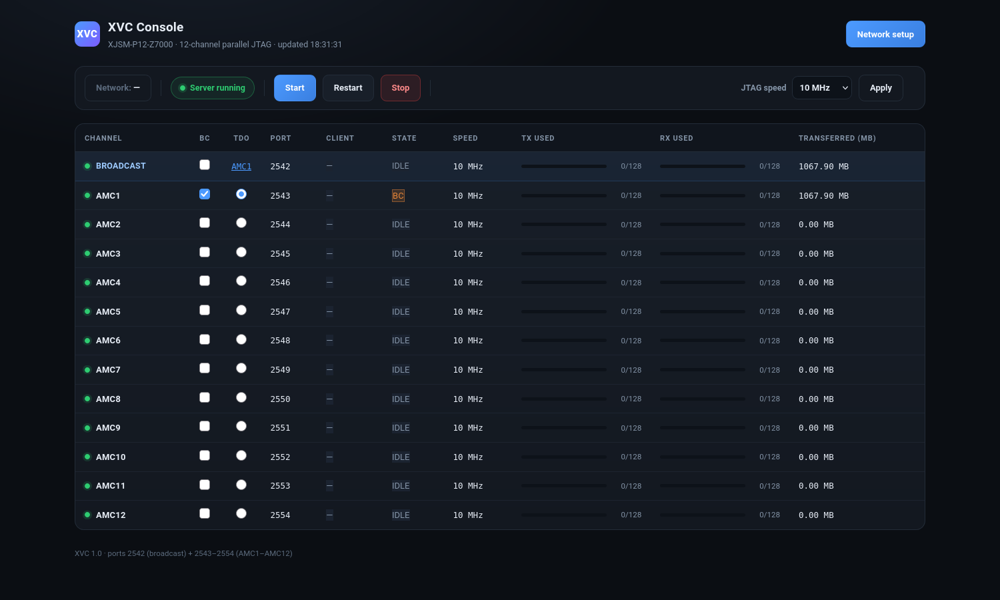

# XVC Web Console



> 2026-10-31
> Address: **http://192.168.1.113/**

## Features

| Area | Content |
|---|---|
| Top cards | Server status, connected clients, online channels, TCK |
| Control bar | Start / Restart / Stop / set DIV |
| Channel table | Status, PL_TAG, DIV, TCK, FIFO headroom and completed blocks for the 12 channels |

The page auto-refreshes every 1.5 seconds.

## Implementation

```
browser ──HTTP:80──> BusyBox httpd (PS)
                          ├── /var/www/index.html      static page
                          └── /var/www/cgi-bin/
                                ├── status   → xvcinfo json
                                └── control  → xvcinfo start|stop|restart|div
```

### Backend: `/usr/bin/xvcinfo`

| Command | Description |
|---|---|
| `xvcinfo json` | Output JSON with the status of the 12 channels |
| `xvcinfo start` | Start `/tmp/xv12p` |
| `xvcinfo stop` | Stop |
| `xvcinfo restart` | Restart |
| `xvcinfo div <n>` | Set DIV for all channels |

Reads the registers of all 12 channels directly through `/dev/mem`:
- `0x14`: PL_TAG (`0xA7xxxxxx`)
- `0x18`: DIV readback
- `0x24`: STATUS (tx_free / rx_used)
- `0x28`: number of completed blocks
- `0x30`: STATE (busy / stream_chunk / bits / state)

### Deployment (current method, lost after reboot)

```bash
# host side
python3 -m http.server 8020 -d xvc/web

# board side
mkdir -p /var/www/cgi-bin
cd /var/www
wget -q http://<host>:8020/index.html -O index.html
wget -q http://<host>:8020/cgi-bin/status -O cgi-bin/status
wget -q http://<host>:8020/cgi-bin/control -O cgi-bin/control
wget -q http://<host>:8015/xvcinfo -O /usr/bin/xvcinfo
chmod +x cgi-bin/* /usr/bin/xvcinfo
httpd -p 80 -h /var/www
```

### Baking into the image (next build)

Already added to the PetaLinux recipes:

- `project-spec/meta-user/recipes-apps/xvcinfo/` (backend)
- `project-spec/configs/rootfs_config`: `CONFIG_xvcinfo=y`

The web files still need to be added to the rootfs (`/var/www`) — not yet in a recipe.

## Measured

```
GET  /                → 200, 5484 bytes
GET  /cgi-bin/status  → {"server_pid":834,"clients":1,"nch":12,"channels":[...]}
POST ?cmd=div&v=5     → div=5 (10.000 MHz)
POST ?cmd=restart     → restarted pid=899
```

## Screenshot (text version)

```
XVC Console
XJSM-P12-Z7000 · 12-channel parallel XVC · updated 17:36:12

┌──────────┬──────────┬──────────┬──────────┐
│ Server   │ Client   │ Online   │ TCK      │
│ Running  │ 1        │ 12 / 12  │ 10.000MHz│
└──────────┴──────────┴──────────┴──────────┘

[Start] [Restart] [Stop]  DIV [5] [Apply]

Ch    Port   State   PL_TAG       DIV  TCK        tx_free  Blocks
● ch0  2543  idle    0xA7000000   5    10.000MHz  128      5734580
● ch1  2544  idle    0xA7000000   5    10.000MHz  128      6250
...
```
